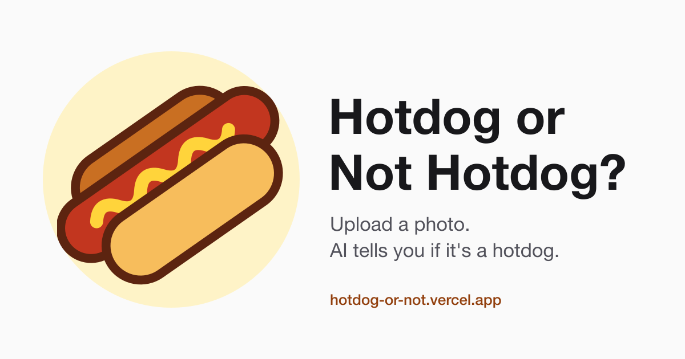
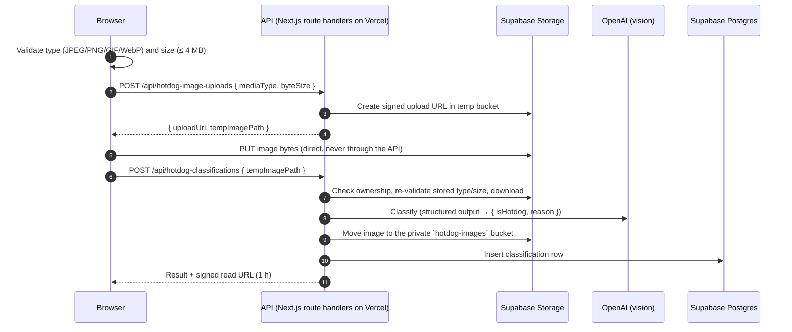

# Hotdog or Not Hotdog

Upload a photo and an AI vision model tells you whether it's a hotdog — with a one-line reason — and keeps a history of your past checks.

**Live:** https://hotdog-or-not.vercel.app



## How it works



- **No login.** A visitor is identified by an `HttpOnly`, `Secure`, `SameSite=Lax` session cookie issued by `proxy.ts`. Storage paths use a separate non-secret folder id, so the cookie value never appears in a URL.
- **Images never pass through the API.** Uploads go straight to storage with a short-lived, single-use signed URL. The API re-checks the stored object before using it.
- **Supabase is server-only.** The service-role key lives only in server code (`import 'server-only'`). Every table has row-level security enabled with no policies, and both buckets are private.
- **Retry-safe.** If classification fails before the image is moved, the client can retry with the same `tempImagePath`. A retry after success returns the existing record.

## Tech stack

| Area    | Choice                                                                                           |
| ------- | ------------------------------------------------------------------------------------------------ |
| App     | Next.js 16 (App Router, Cache Components), React 19, TypeScript                                  |
| Styling | Tailwind CSS v4 with design tokens in `app/globals.css` (light and dark)                         |
| AI      | OpenAI Responses API with structured outputs validated by zod (`gpt-5.4-mini`, low image detail) |
| Data    | Supabase Postgres + Storage (London, `eu-west-2`)                                                |
| Hosting | Vercel (functions in London, `lhr1`)                                                             |
| Tooling | Node 24, Yarn 4, Vitest, ESLint, Prettier                                                        |

## Project structure

```
app/            Routes; app/api/**/route.ts are thin adapters to server/ handlers
components/     UI by domain; components/primitives/ for shared building blocks
hooks/          Stateful UI logic, kept out of components
controllers/    API controller instances used by the browser
server/         Server-only: api/[domain]/ handlers + services, clients/ (OpenAI, Supabase)
shared/         Isomorphic types, constants, validators, API controllers
supabase/       Local Supabase config + SQL migrations (tables, RLS, storage buckets)
test/           API tests and shared fakes
```

Request flow: `component → hook → shared/controllers → app/api/**/route.ts → server handler → service → client`.

Conventions and rules live in [`CLAUDE.md`](CLAUDE.md) and [`guidelines/`](guidelines/). Feature plans live in [`plans/`](plans/).

## Run locally

Prerequisites: Node 24 ([`nvm`](https://github.com/nvm-sh/nvm)), Corepack (ships with Node, provides Yarn 4), and Docker (for local Supabase).

```bash
nvm use
corepack enable
yarn install

yarn db:start                  # starts local Supabase and applies migrations; prints the keys
cp .env.example .env.local     # fill in the values below
yarn dev                       # http://localhost:3000
```

| Variable                    | Where to get it                                                                     |
| --------------------------- | ----------------------------------------------------------------------------------- |
| `OPENAI_API_KEY`            | https://platform.openai.com/api-keys                                                |
| `SUPABASE_URL`              | `http://127.0.0.1:54321` locally; Project URL in the Supabase dashboard             |
| `SUPABASE_SERVICE_ROLE_KEY` | `yarn supabase status -o env` locally; Project Settings → API Keys in the dashboard |

All three are server-only — never prefix them with `NEXT_PUBLIC_`.

## Scripts

| Command                                  | What it does                                              |
| ---------------------------------------- | --------------------------------------------------------- |
| `yarn dev`                               | Dev server (web + API)                                    |
| `yarn typecheck`                         | Generate route types and run `tsc`                        |
| `yarn lint`                              | ESLint                                                    |
| `yarn test` / `yarn test:run`            | Vitest (watch / single run)                               |
| `yarn build`                             | Production build                                          |
| `yarn db:start` / `db:stop` / `db:reset` | Local Supabase lifecycle                                  |
| `yarn db:types`                          | Regenerate the Postgres types in `shared/types/database/` |
| `yarn db:push`                           | Apply migrations to the linked remote project             |

## Testing

- Unit tests sit next to the code they cover (`*.test.ts`).
- API tests in `test/api-tests/` call the real route handlers with fake OpenAI and Supabase clients from `test/helpers/`, so the suite needs no network access or secrets.

## Deployment

Pushing to `main` deploys to production on Vercel; other branches get preview deployments. Database changes are SQL migrations in `supabase/migrations/`, applied with `yarn db:push` before the code that needs them is deployed. Step-by-step setup is in [`CLAUDE.md` → Deploy](CLAUDE.md#deploy).

## Status and roadmap

- **v0.2 (live):** signed upload flow, classification history, anonymous visitor session, onboarding, cookie banner.
- **v0.3 (in progress):** responsive layout, richer classification details, consent-based guest mode, data deletion with an audit trail, photo location stripping — see [`plans/`](plans/).
- **Production readiness:** findings and recommended next steps are in [`docs/production-readiness.md`](docs/production-readiness.md).
